<p align="center"></p>

<h1 align="center">Ticketrail</h1>

<p align="center"><b>Put it on the rail. Claude picks it up.</b></p>

A ticket rail for your coding agent: a kanban board that lives inside your project and that
Claude Code works from.

Building with Claude Code is iterative — you prompt, review, prompt again. Those prompts
end up in terminal scrollback or in a ticket far away from the code. Ticketrail puts them
on a board in the repo instead: you queue cards, Claude picks them up, plans or builds them,
asks you questions inside the card, and moves them along. The UI updates live while it works,
down to every command Claude runs.

The whole bridge is plain JSON on disk. The React UI writes it, Claude writes it, and
`chokidar` tells everyone else. No daemon, no database, no service to sign up for.

```
┌──────────────┐   HTTP/SSE   ┌──────────────┐   fs read/write   ┌─────────────────┐
│  React UI    │◄────────────►│  Node server │◄─────────────────►│ .ticketrail/    │
│  (the board) │              │  + chokidar  │                   │   tasks/*.json  │
└──────────────┘              └──────────────┘                   └─────────────────┘
                                                                          ▲
                                                                  ┌───────┴────────┐
                                                                  │   ticketrail   │
                                                                  │  CLI (Claude)  │
                                                                  └────────────────┘
```

> **New here and not a programmer?** Start with the [friendly guide](#-the-friendly-guide) just
> below. Everything after it is the technical reference.

## 🧭 The friendly guide

*No coding knowledge needed. Grab a coffee, this takes five minutes.* ☕

### What is this, in one sentence?

Ticketrail is a **to-do board you share with Claude**. You write down what you want on a card,
drag the card into a column, and Claude, the AI assistant, picks it up and does the work while
you watch.

Think of it as sticky notes on a wall, except one colleague at the wall never gets tired and
writes a note back on every card when it's done. 🗒️➡️🤖➡️✅

<p align="center">
  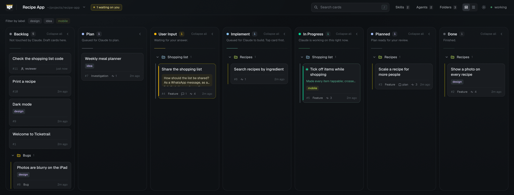
  <br><sub><i>A board for a small recipe app. Every card is one wish; the columns show how far along it is.</i></sub>
</p>

### The columns, left to right

| | Column | What it means for you |
|---|---|---|
| 📝 | **Backlog** | Your notepad. Write ideas here; Claude leaves them alone. |
| 🧠 | **Plan** | "Please think this through first." Claude writes a plan and changes nothing. |
| ✋ | **User Input** | Claude has a question for **you**. These cards glow yellow. |
| 🛠️ | **Implement** | "Please build this." Claude starts with the top card. |
| ⚡ | **In Progress** | Claude is working on it right now. Watch it live. |
| 📋 | **Planned** | A plan is ready for you to read. |
| ✅ | **Done** | Finished, with a short note on what was done. |

You only ever move cards into **Plan** or **Implement**. Claude moves them along from there.

### Your first card, step by step

1. **Write it down.** Click **+ Add a card** at the bottom of *Backlog* and describe what you want
   in plain words, as you would tell a colleague. *"I want to cook for 6 instead of 2 and have the
   amounts change by themselves"* is a perfect card.
2. **Drag it to _Plan_** if you'd like to see the idea first. Drag it to **Implement** if you just
   want it done.
3. **Lean back.** 🍿 The card jumps to *In Progress*, and a green line on it tells you what
   Claude is doing at that moment.

> 💡 **Tip:** a picture says more than a paragraph. Open the card's **Files** tab and paste a
> screenshot (<kbd>⌘</kbd>+<kbd>V</kbd>) or drop a file there. Claude looks at it before starting.

### Reading a plan 📋

When Claude has planned a card, it lands in **Planned**. Click it to read the plan: what will
change, in which steps, and how to tell that it works.

<p align="center">
  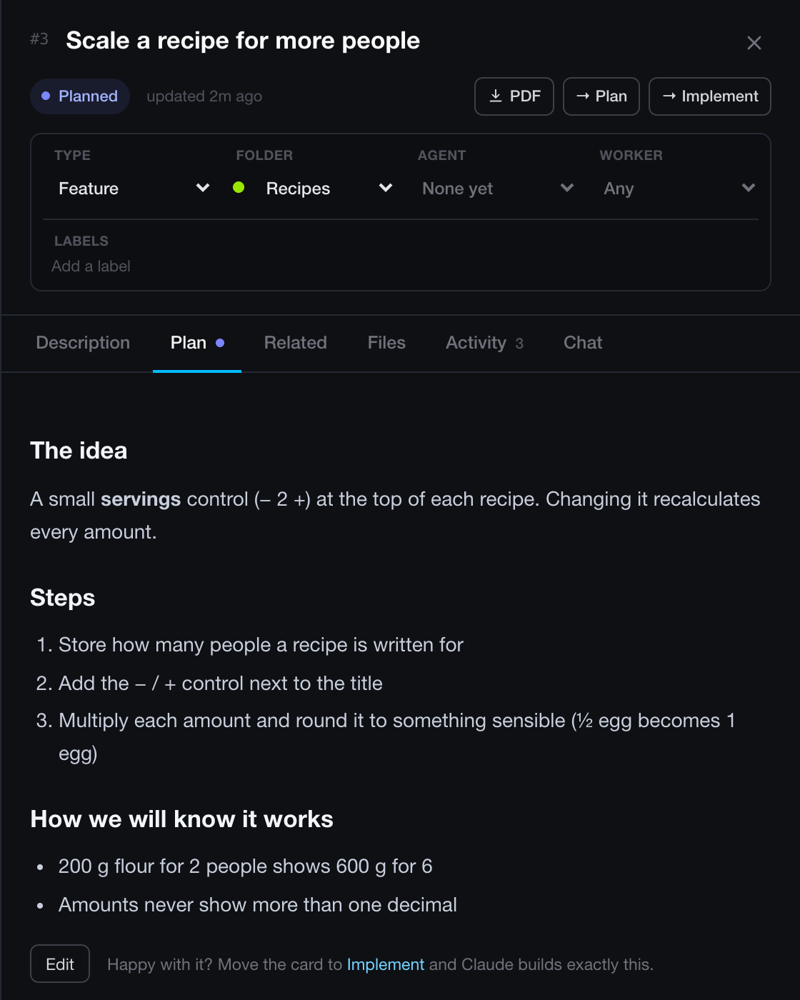
</p>

- **Happy with it?** Drag the card to **Implement** (or press **→ Implement**). Claude builds
  exactly what the plan says.
- **Want something different?** Press **Edit** and change the plan yourself, or write in the
  card's **Chat** what you'd like changed, then send it back to **Plan**.

### When Claude asks you something ✋

Sometimes there is a decision only you can make. The card moves to **User Input** and glows
yellow, and a badge at the top of the board says **"1 waiting on you"**.

<p align="center">
  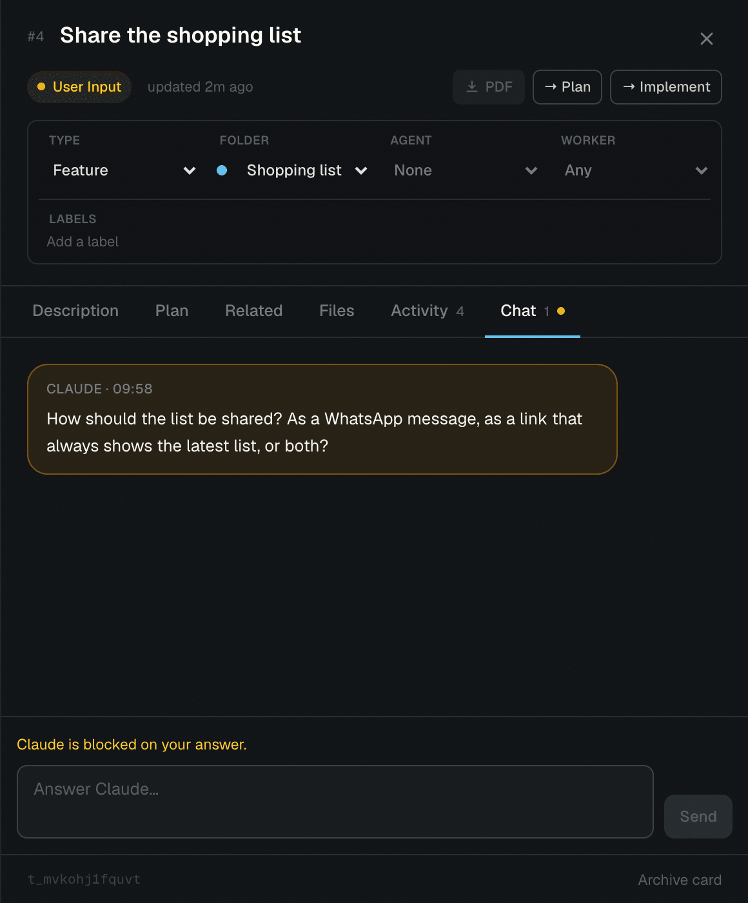
</p>

Open the card, type your answer in the **Chat**, and press **Send**. That's it. Claude reads
it and carries on by itself.

### Watching the work ⚡

While a card is *In Progress*, its **Activity** tab fills up step by step. You can see what
Claude did, and when.

<p align="center">
  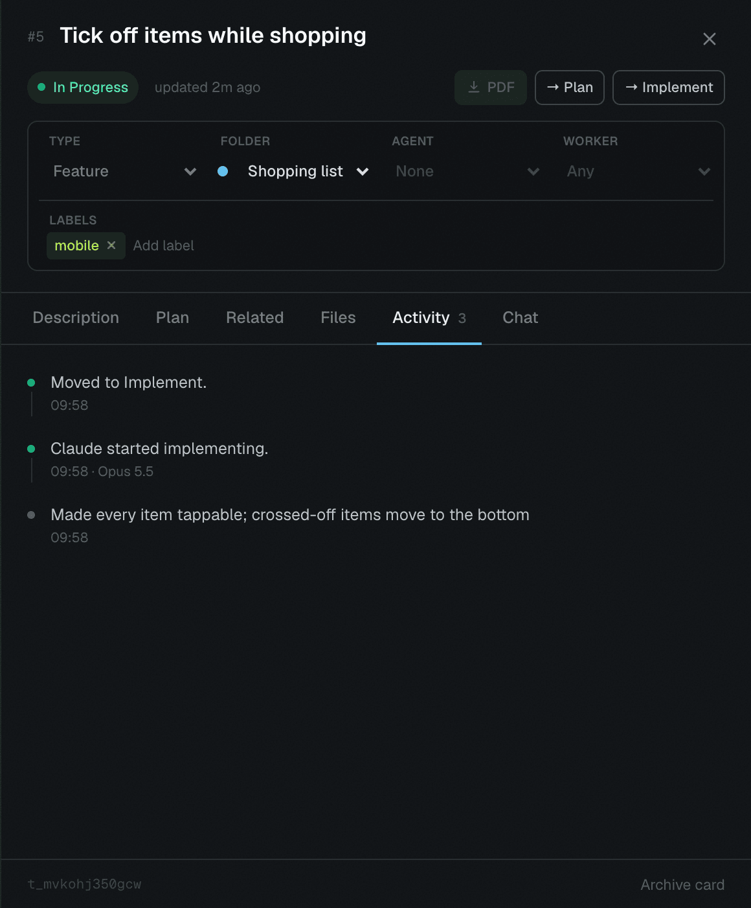
</p>

Want to see everything, the way the worker's terminal shows it? Open the **Session** tab. It
streams Claude's messages and every command, file read and edit as they happen, with the output
folded underneath each one (errors open by themselves). It follows the bottom like a terminal; scroll
up to read and a *Jump to latest* button brings you back. If the card went to an agent, the
agent's own steps appear indented under it.

<p align="center">
  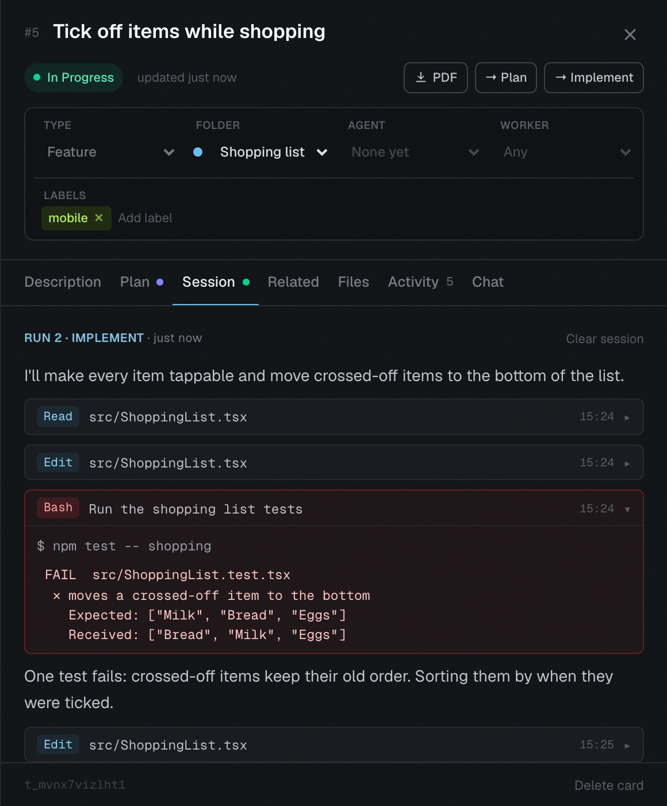
</p>

Every run is kept: the latest one is always shown, and the runs before it are listed underneath,
collapsed, like earlier results.

<p align="center">
  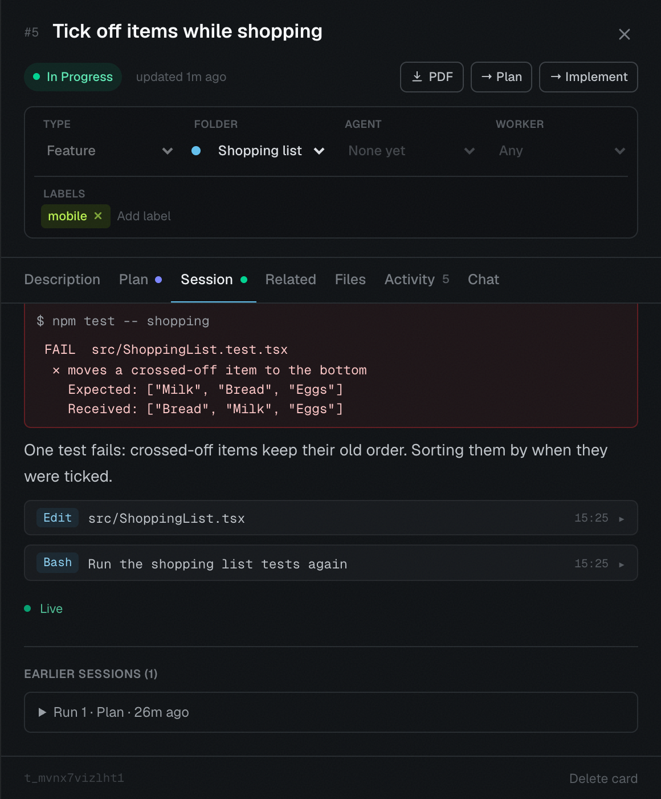
</p>

**Clear session** at the top of the tab removes a card's sessions once its run has finished. To stop
keeping them at all, turn off **Keep session history** in Settings ⚙️.

Changed your mind halfway? Just write in the card's **Chat** or add a file. Claude picks it up
at its next step. (Type, agent and worker are locked while it works, so the card can't change
hands mid-way.)

### When it's done ✅

Finished cards land in **Done**. The **Result** tab says, in plain words, what changed and how
it was checked.

<p align="center">
  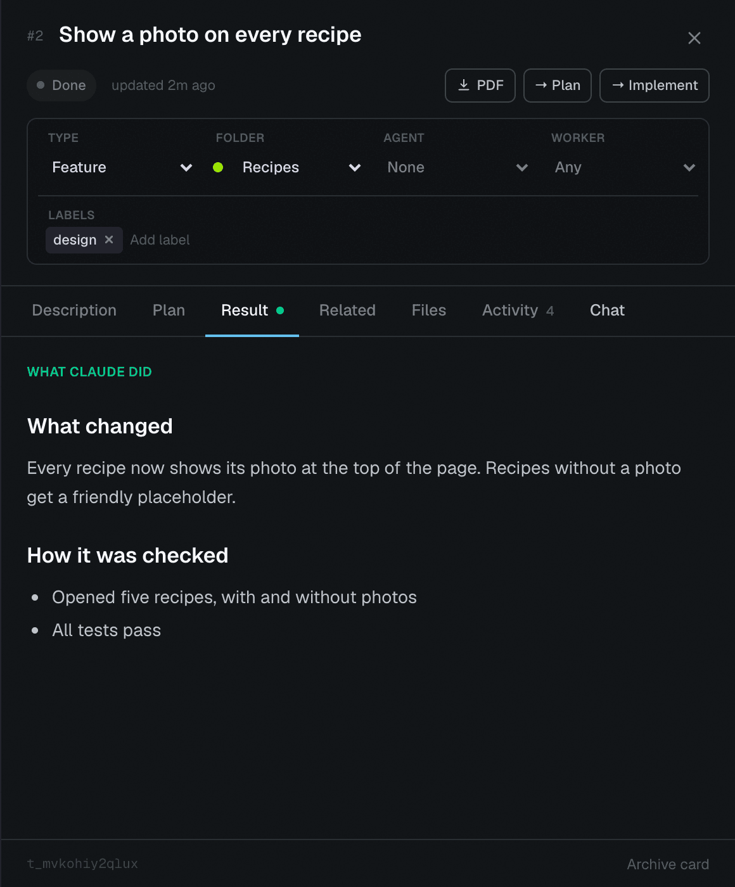
</p>

Not quite right? Write what's missing in the **Chat** and drag the card back to **Implement**.
The earlier result is kept further down, so nothing gets lost.

### Handy extras 🎁

- 🔎 **Search:** press <kbd>/</kbd> and type a word to find any card.
- 📁 **Folders:** group cards by topic ("Shopping list", "Recipes"). Optional, purely for tidiness.
- 🏷️ **Labels:** little coloured tags such as `design` or `mobile`. Click one at the top to show
  only those cards.
- 🔗 **Related cards:** drop a card onto another card to say "read this one too". Handy for a bug
  that belongs to an earlier feature. **Relations** at the top shows every card and the arrows
  between them; draw a line from one card to another to link them, and press **Tidy up** to
  sort the picture.
- 🖥️ **Session:** every card keeps what Claude did on it, step by step, run by run. Open the
  card's **Session** tab to watch live or look back later.
- 🔔 **Alerts:** the ⚙️ menu can play a sound or show a notification when a card moves, so you
  don't have to keep watching.
- 🗂️ **Several projects:** click the project name at the top left to switch between boards.

### Setting it up, step by step 🚀

You need to do this **once**. It takes about ten minutes, and each step is a single line to copy.
"Terminal" is the app on your Mac (find it with <kbd>⌘</kbd>+<kbd>Space</kbd>, type *Terminal*).
Paste a line, press <kbd>Enter</kbd>, wait until it's finished, then go on.

1. **Install Node.js.** Download the *LTS* version from [nodejs.org](https://nodejs.org) and
   double-click the installer.
2. **Install Claude Code**, the AI assistant that does the work:
   ```bash
   npm install -g @anthropic-ai/claude-code
   ```
3. **Download Ticketrail** and make it known to your computer:
   ```bash
   git clone https://github.com/marc-porst/ticketrail.git
   npm i -g ./ticketrail
   ```

That's the whole installation. 🎉

### Starting the board ▶️

Every time you want to use the board, start it with the start script:

```bash
cd ticketrail
./start.sh
```

<p align="center">
  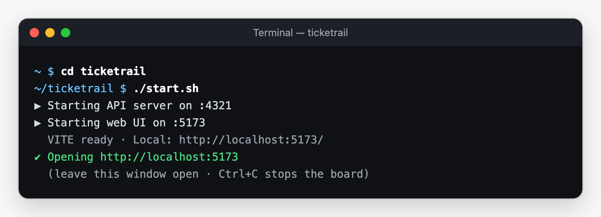
</p>

The script sets everything up (the very first start takes a minute longer) and then **opens the
board in your browser by itself**, at **http://localhost:5173**.

> ⚠️ **Leave this Terminal window open** while you use the board. Closing it, or pressing
> <kbd>Ctrl</kbd>+<kbd>C</kbd> in it, switches the board off. To start again, run `./start.sh`.

### Adding a new space 🗂️

A **space** is one project with its own board: a website, an app, a folder full of documents.
You can have as many as you like and switch between them.

**Step 1: open the space menu.** Click the project name at the top left of the board. You see
every space you have, and how many cards are waiting in each.

<p align="center">
  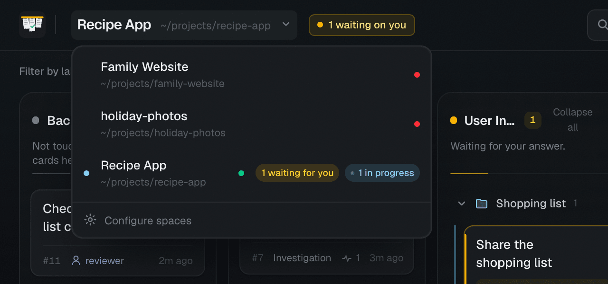
</p>

**Step 2: click _Configure spaces_** at the bottom of that menu.

<p align="center">
  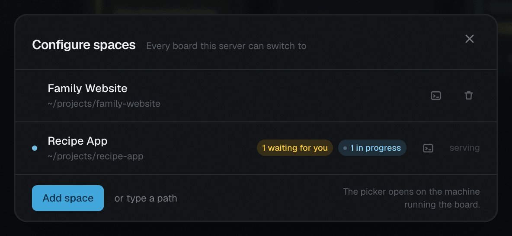
</p>

**Step 3: click _Add space_.** Your Mac's normal folder window opens. Pick your project's folder
and confirm. *(Prefer typing? Click **or type a path** instead, type the folder, and press **Add**.)*

<p align="center">
  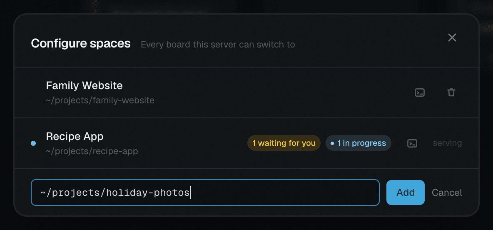
</p>

**Step 4: copy the start line.** The new space appears in the list with **Added.** and one line
underneath. Press **copy** next to it.

<p align="center">
  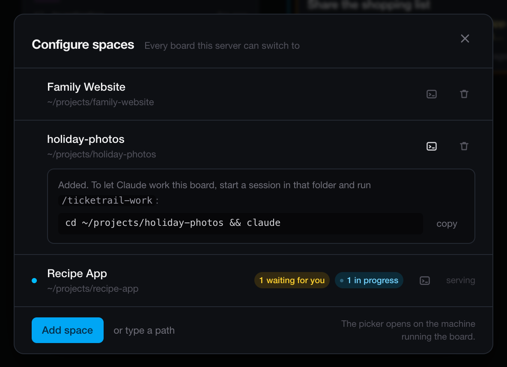
</p>

**Step 5: wake Claude up for this space.** Open a **new** Terminal window (<kbd>⌘</kbd>+<kbd>N</kbd>
in Terminal), paste the line you copied, and press <kbd>Enter</kbd>. Claude starts. Then type
`/ticketrail-work` and press <kbd>Enter</kbd>.

<p align="center">
  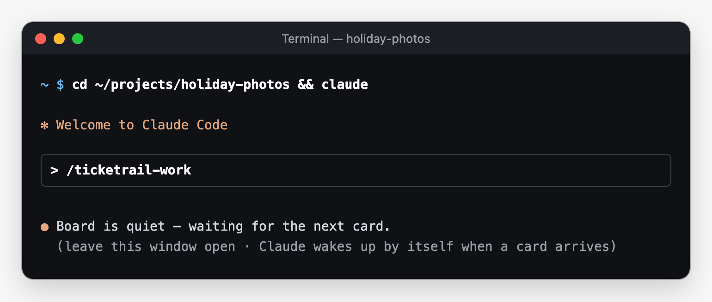
</p>

Claude now says it's waiting for cards. Leave this window open, too. ☕ Back on the board, the
dot at the top right turns green and reads **worker ready**.

**Step 6: done!** Pick the new space in the project menu and write your first card. Each space
needs its own Claude window (step 5); the board itself serves all of them.

> 💡 Forgot the start line? Open **Configure spaces** again and click the little
> **terminal icon** (▸_) next to a space: the line shows up again.

### Your daily routine ☀️

1. Start the board: `cd ticketrail` and `./start.sh` (the browser opens by itself).
2. For each space you want Claude to work on, open a Terminal window, go to the project with
   `cd …` and run `claude`, then type `/ticketrail-work`.
3. Check the dot at the top right: **worker ready** or **working** means Claude is on duty.
4. Write cards and drag them. ✨

### Skills: teach Claude your house rules 📚

A **skill** is a short note of instructions that Claude reads by itself whenever a card is about
that topic. Write it once, and you never have to repeat yourself on a card again. Examples:
*"how our recipes are written"*, *"our brand colours"*, *"how we name files"*.

**Step 1: click _Skills_** at the top right of the board. On the left you see every skill of the
open space. Click one to read it.

<p align="center">
  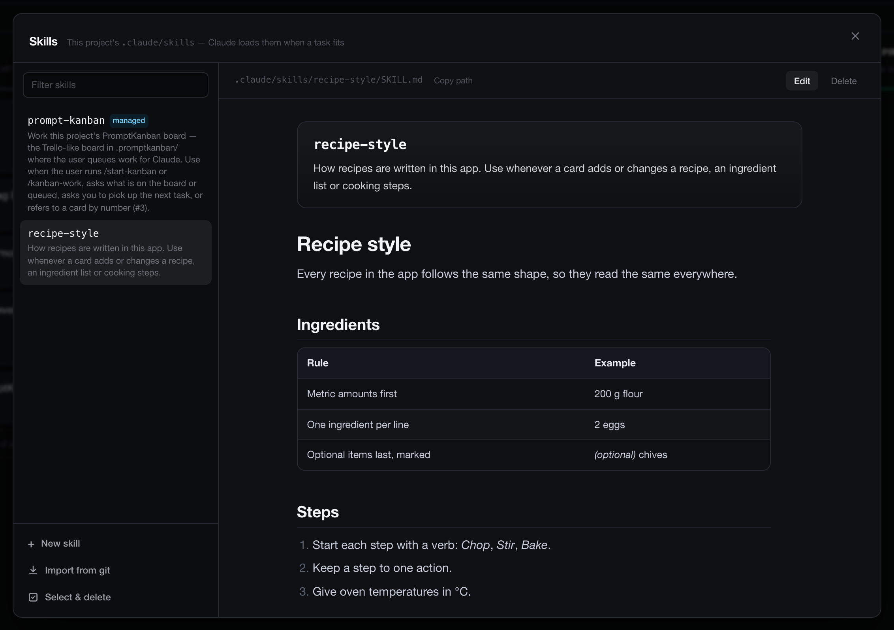
</p>

> The skill called `ticketrail` (marked *managed*) is the one that lets Claude use the board.
> It can't be deleted. Just leave it be.

**Step 2: click _+ New skill_** at the bottom left to write your own.

**Step 3: give it a name and a description.** The name is short, in lowercase letters with
hyphens (`shopping-list`). The description is the important part: it tells Claude **what** the
skill is about and **when** to use it. Then click **Create skill**.

<p align="center">
  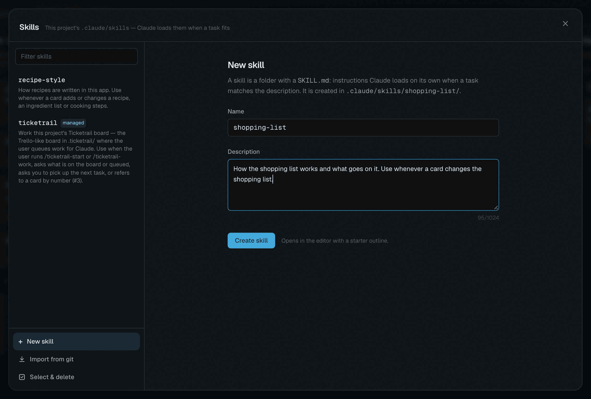
</p>

**Step 4: write the instructions.** An editor opens with a starter outline. Write your rules in
plain words, like a note to a new colleague. On the right you see how it will look. Save with
<kbd>⌘</kbd>+<kbd>S</kbd>.

That's it. From now on, every card about the shopping list gets your rules automatically. 🎯

**Bonus: borrow skills from others.** Click **Import from git**, paste a link to a collection of
skills (for example a GitHub page), press **Load skills**, tick the ones you want, and press
**Import**.

<p align="center">
  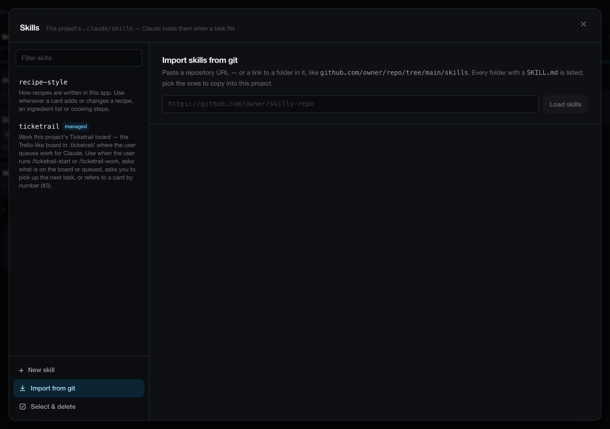
</p>

To change a skill later, click it and press **Edit**. To remove it, press **Delete**.

### Agents: give a card to a specialist 🧑‍🔧

An **agent** is a Claude with a fixed role, such as a *reviewer* who checks work for mistakes or a
*docs writer* who writes help pages. Give a card to an agent and that specialist does the work,
with its own instructions.

**Step 1: click _Agents_** at the top right of the board, then **+ New agent** at the bottom left.

**Step 2: pick a starting point.** Under *Start from*, click one of the ready-made roles:
**Reviewer**, **Tester**, **Frontend developer** or **Docs writer**. Name and description fill
themselves in. (**Blank** lets you write your own role from scratch.)

<p align="center">
  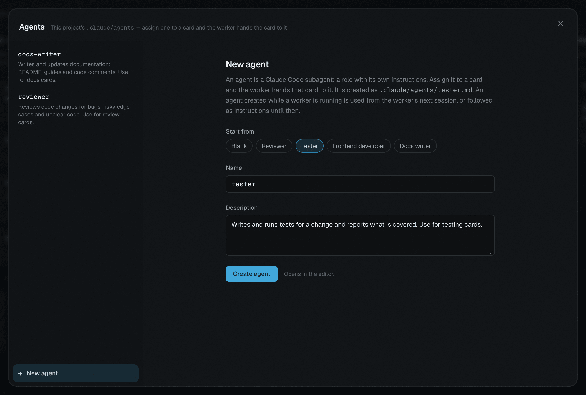
</p>

**Step 3: click _Create agent_.** An editor opens with the agent's instructions. Adjust them if
you like and save with <kbd>⌘</kbd>+<kbd>S</kbd>.

**Step 4: give a card to the agent.** Open any card. In the **Agent** box at the top, pick your
agent. A little 👤 with the agent's name now shows on the card on the board.

<p align="center">
  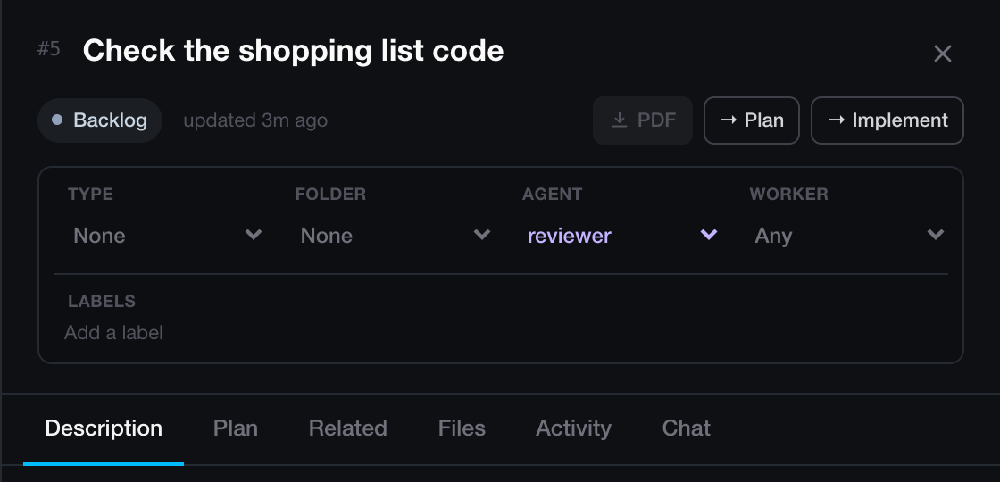
</p>

**Step 5: drag the card to _Plan_ or _Implement_** as usual. Claude hands it to the specialist,
and the result lands in *Done* like any other card.

> 💡 **New agent, but Claude is already running?** Claude picks up brand-new agents the next time
> you start it. Until then it still follows the agent's instructions, so nothing is lost. Choose
> **None** in the Agent box to let Claude do a card itself again.

### Several Claudes at once: named workers 🤖

One Claude works one card at a time. Want more done in parallel? Start **several** Claude
windows for the same space and give each one a **name** and a **job**.

**Step 1: label your cards.** Open a card and add a label in the **Labels** box, for example
`frontend` for anything about how the app looks, and `backend` for everything behind the scenes.

**Step 2: start one Claude per job.** For each worker, open a new Terminal window, go to the project
and start Claude (the same line as in step 5 of *Adding a new space*). Then type `/ticketrail-work`
followed by a **name** and, after `--only`, **which cards** it should take:

```
/ticketrail-work fe --only label:frontend
```
```
/ticketrail-work be --only label:backend
```

Now `fe` only picks up cards labelled *frontend*, and `be` only those labelled *backend*. A plain
`/ticketrail-work` without a name takes any card.

**Step 3: check who's on duty.** Click the dot at the top right of the board. It lists every waiting
worker with its name and its filter.

**Step 4 (optional): send one card to one worker.** In a card's **Worker** box, pick a worker's
name. Only that worker may take the card. **Any** lets every worker take it again.

> 💡 **What can go after `--only`?** `label:…`, `type:…` (e.g. `type:bug`), `folder:…` (a folder's
> name) and `agent:…`. Separate several with commas and no spaces:
> - `label:frontend,label:design` takes cards with **either** label.
> - `label:frontend,type:bug` takes only cards that are **both**: a frontend bug.
> - `none` means "has nothing set", e.g. `folder:none` for cards outside any folder.

### Little questions, quick answers

<details>
<summary><b>Can Claude change things I didn't ask for?</b></summary>

Claude only works on cards you moved into <b>Plan</b> or <b>Implement</b>. Cards in <i>Backlog</i>
are never touched. A card in <i>Plan</i> never changes anything, it only produces a plan to read.
</details>

<details>
<summary><b>I dragged a card by mistake. Now what?</b></summary>

Drag it back. If Claude already started, dragging it out of <i>In Progress</i> tells Claude to stop.
</details>

<details>
<summary><b>Is my data sent anywhere?</b></summary>

The board itself is just files inside your project folder. There's no account and no cloud
service. Claude works on your computer like it always does.
</details>

<details>
<summary><b>How long can I look back at what Claude did on a card?</b></summary>

As long as you like. The <b>Session</b> tab keeps a copy of every run with the card, separate
from Claude Code's own files (which it deletes after 30 days), up to the last 20 runs per card.
To remove it, use <b>Clear session</b> at the top of the tab. To stop keeping copies at all, turn
off <b>Keep session history</b> in Settings ⚙️.
</details>

<details>
<summary><b>The dot at the top right is red or grey.</b></summary>

Red (<i>offline</i>) means the page can't reach the board server. Reload the page, and if that
doesn't help, start the board again with <code>./start.sh</code>. Grey (<i>no worker</i>) means nobody
is picking up cards right now. Do step 5 of <a href="#adding-a-new-space-">Adding a new space</a> again.
</details>

---


## Install

The repo is private and not on npm yet, so install it from a clone:

```bash
git clone https://github.com/marc-porst/ticketrail.git
npm i -g ./ticketrail
```

Needs Node 20 or newer. Installing a local folder symlinks it, so `npm run build` in the clone
takes effect everywhere immediately — there is nothing to reinstall after a change.

Do **not** use `npm i -g github:marc-porst/ticketrail`. npm symlinks the package to a temporary
clone under `~/.npm/_cacache/tmp/` and then deletes it, leaving a command that points at
nothing. Installing the folder avoids that entirely.

Once the project is finished this becomes `npm i -g ticketrail`.

## Getting started

In the project you want a board for:

```bash
cd ~/my-project
ticketrail init
```

That is a shell command — run it in a terminal, or as `! ticketrail init` inside a Claude
Code session. It creates `.ticketrail/` for the board data and installs the skill plus the
`/ticketrail-start`, `/ticketrail-work` and `/ticketrail-add` commands into that project's `.claude/`.

Now open Claude Code there. The first time, run `/reload-skills` so it picks up the new
commands, then:

```
/ticketrail-start     # starts the board at http://localhost:4321
/ticketrail-work      # here or in a second session — Claude starts pulling cards
```

`/ticketrail-work` blocks on the board and takes a card the moment you drag one into **Plan** or
**Implement**. Wrap it in `/loop /ticketrail-work` to leave it running unattended.

## Several projects, one board

One server serves every project you have registered — a board is just files on disk, so there
is no reason to run a process per project. The project name in the header is a switcher: it
lists each board with its queued and in-progress counts, marks any that are waiting on your
answer, and swaps the board in place when you pick one. The selection lives in the URL, so a
board stays bookmarkable, and the browser tab is named after it.

Projects register themselves when you run `init` or `serve` in them. **Configure spaces**, at
the foot of the switcher, manages the list from the UI: rename a space in place, remove one
behind a confirmation, or add one with **Add space**, which opens your OS's real folder
chooser. A folder that has no board yet is initialised as one — the same thing
`ticketrail init` does — so adding a project no longer means a trip to a terminal.

What the modal *cannot* do is start the worker: that needs a Claude Code session whose working
directory is the project, so each row hands you the `cd … && claude` to run, and you type
`/ticketrail-work` there. Removing a space only unregisters it; nothing on disk is touched.

The same operations from a terminal:

```bash
ticketrail projects                  # every board, with counts
ticketrail projects add <path>       # register one
ticketrail projects remove <path>    # forget one
```

The registry is `~/.ticketrail/projects.json`. Registration used to be terminal-only so that
no website you happen to be visiting could point the server at a folder. Three things keep that
true now that it is in the UI: every non-GET request must be same-origin, so another page cannot
call these routes at all; the folder chooser is refused unless the request came from the machine
running the server; and it is a native dialog, so a *human* picks the folder — nothing on the
page chooses it.

The project name comes from `package.json` or the directory; override it in the modal, with
`ticketrail init --title "My Project"`, or by editing `title` in `.ticketrail/config.json`.

The board also works without Claude Code:

```bash
ticketrail init
ticketrail serve --open
```

## The columns

| Column | Who moves it | Meaning |
|---|---|---|
| **Backlog** | you | Your drafts. Claude never touches these. |
| **Plan** | you | Queued for Claude to plan — no code gets written. |
| **User Input** | Claude | Blocked on your answer, asked inside the card. |
| **Implement** | you | Queued for Claude to build. Top card first. |
| **In Progress** | Claude | Being worked on right now. |
| **Planned** | Claude | A plan is waiting for your review. |
| **Done** | Claude | Finished, with a summary on the card. |

The normal path is Backlog → Plan → *(review the plan)* → Implement → Done. Drag a card
straight from Backlog to Implement to skip planning; Claude then works from the description.
When a plan exists on a card, that plan is the spec.

## Working a card

Each card carries a description, the plan Claude wrote, an activity feed of what it is doing
right now, and a chat thread. When Claude needs a decision it asks in the thread and the card
moves to **User Input** — you answer in the card, and the blocked worker picks the answer up
and carries on. You never have to switch to the terminal.

## Card types

A card can carry a type — Feature, Bug, Investigation, or Question — set from the dropdown in
its header or with `ticketrail add --type <type>`. Feature and Bug are classification only;
Claude works the card exactly as its mode says. Investigation and Question behave differently:
Claude never writes code for either, no matter which queue the card arrived through. An
Investigation produces a plan of findings and stops there; a Question produces an answer and
finishes the same way `done` finishes any other card. Drag either one to Implement and the move
is refused with an explanation, rather than quietly doing nothing.

An Investigation whose plan reads well becomes real work through **Create implementation
task**, next to the plan, or `ticketrail derive <id>` from a terminal. That copies the plan
onto a new Feature card, already sitting in Implement — the worker contract already treats a
stored plan as an approved spec, so there is nothing left to review before Claude can build it.

## Search

The search box in the header filters every lane as you type. It only looks at each card's
**title and description**. Every word must appear, in any order, ignoring case and accents, so
`auth middleware` finds "Extract the auth middleware". Press `/` to jump to the box and `Esc` to
clear it. It works together with the label filter.

## Labels

Free-text tags with no behavior beyond letting you filter and skim a crowded board — color comes
from the text itself, so the same label is always the same color without a registry to keep in
sync. Edit them in the card's header, or from a terminal:

```bash
ticketrail label <id> --add urgent --remove stale
ticketrail list --type bug --label urgent
```

Up to 8 labels per card, 32 characters each. Matching is case-insensitive so "API" and "api"
can't both end up on the same card, but whichever case you typed first is what is kept.

## Files on a card

Drop a screenshot onto a card — or just paste one — and Claude opens it before it starts. Files
are stored in `.ticketrail/files/`, and the card's JSON records the id of each one, so the
board stays portable; the absolute path is resolved only when Claude asks for it.

The **Files** tab of a card takes drag and drop, a paste (`⌘V` anywhere in the card), or a file
picker. Images get thumbnails and open full size on click. Claude can attach files back the same
way — a screenshot of what it built, a failing test log:

```bash
ticketrail attach <id> ./screenshot.png
ticketrail files <id>            # every attachment with a path to open
```

`next` and `show` add an absolute `path` to each attachment, which is what makes a screenshot
usable to Claude rather than just visible to you. Limit is 25 MB per file.

Attachments are committed with the board by default, so they travel with the repo. If you would
rather not have binaries in git, add `.ticketrail/files/` to `.gitignore` — the cards still
work locally, they just lose their files on another machine.

## Related cards

Sometimes a card only makes sense next to another one: a bug in a feature you just shipped, one
part of a feature that was split up, a constraint decided on an earlier card. Link those cards in
the **Related** tab of the card. Type a `#number` or part of a title and press Enter. You can link
up to 12 cards.

You can also **drag a card onto another card**. Drop it on the lower part of the target, where the
card shows **Link as related**, and the card you dragged becomes related context of the card you
dropped it on. Neither card moves. A drop on the top edge still reorders, as before. A card that
other cards link shows `←n` next to the link icon, and lists those cards under **Referenced by** in
its Related tab.

When Claude claims the card, `next` includes each linked card's description, plan, result and
attachment paths (and the investigation the card was derived from), so Claude reads them as context
and does not have to work out what "see #12" means. Links are one level deep and go one way. The
linked card shows the link under **Referenced by**, but Claude only gets context from the card it
is working on.

```bash
ticketrail relate <id> #12 #14     # link, by id or #number
ticketrail unrelate <id> #12       # unlink
ticketrail add "Fix margins" --related 15
```

### The Relations view

**Relations** in the top bar (with the number of links) opens a map of every card on the board.
Each card shows its lane, type and number. A solid arrow means "reads as context": it runs straight
from the card that holds the link to the card it reads. A dashed violet arrow points from a card to the
investigation it was derived from.

- **See everything at once.** The map opens zoomed so every card and arrow fits the window. Zoom
  with **−** and **+**, Ctrl/⌘ + scroll, or click the percentage to fit again.
- **New card:** use **+ New card**, double-click empty space, or drop a link you are drawing on
  empty space. A small title field appears in that spot; Enter creates the card in Backlog (Esc
  or an empty title cancels). A card made from a dropped link is already linked: the card you
  dragged from reads it.
- **Move** a card by dragging it. The card you moved last stays on top.
- **Link** two cards by hovering a card and dragging from the blue dot on its right edge onto
  another card. The card you start from reads the other one, the same as dropping it on the board.
- **Unlink** by hovering a link and clicking the trash button that appears on it. A click on the
  link itself does nothing, so a link is never removed by accident.
- **Open** a card by clicking it. It opens in a panel on the right of the view, with everything the
  card drawer has (editing, chat, files, Session). The map stays open beside it and marks that card.
  A related card clicked inside the panel replaces it there. Esc closes the panel first, then the view.
- **Tidy up** lays the map out again: each group of linked cards in columns from left to right, in
  an order that keeps arrows from crossing, biggest group first, and cards without links in a grid
  underneath. It fits the layout to the window: a long chain wraps onto the next band like a line
  of text, at whichever width shows the whole map largest. A board opened here for the first time
  starts out tidied the same way.

Hovering a card highlights its links and dims the rest. Where the cards sit is remembered in this
browser only, per project; the links themselves are stored on the cards like any other.

## Folders

Folders are optional. A board without any looks and works exactly as before. When a board gets
busy, group cards into folders with **Folders** in the header (create, rename, recolour, reorder,
delete), or with the **Folder** select in a card's drawer.

A folder belongs to the whole board, and a card keeps its folder as it moves from lane to lane.
Each lane shows the cards it has from a folder as a group you can collapse. Collapsing is
remembered in your browser and changes nothing for Claude. A collapsed group still shows a green
dot when a card inside is in progress and "1 waiting" when one needs your answer.

In each lane, unfiled cards come first, then the folders in their order. Claude claims in that same
order, so the top card you see in Implement is the one picked up next. Dragging works like this:
- drop a card on a folder's header to put it in that folder
- drop it above a card to take that card's folder
- drop it on an empty part of a lane to move it there and keep its folder

To sort folders, drag a folder's header above another folder's header, or onto the empty bottom of a lane to put it last. Folder order is the same in every lane, so sorting in one lane sorts them everywhere.

Deleting a folder keeps its cards, unfiled.

```bash
ticketrail folder add "Auth rework" [--color rose]    # also: rename, color, remove
ticketrail file <id> "Auth rework"                    # or: file <id> none
ticketrail folders                                    # list, with card counts
```

## Skills

**Skills** in the header manages the open space's project skills, the
`.claude/skills/<name>/SKILL.md` folders that Claude Code loads on its own when a task matches a
skill's description. The list on the left shows every skill with its description. The right side
renders the chosen one: its frontmatter as a header, then the instructions as a full document with
tables and highlighted code.

- **Edit** opens the whole `SKILL.md`, frontmatter included, with a live preview. Save with ⌘S.
  If the file changed on disk while you were editing, you choose to reload or overwrite. Nothing is
  silently lost.
- **New skill** asks for a name (lowercase, digits and single hyphens) and a description, then opens
  a starter outline in the editor.
- **Delete** removes the skill's folder after you confirm. **Select & delete** lists every skill with
  a checkbox (and **Select all**) to remove several at once, again behind a confirm.
- **Import from git** takes a repository URL, or a link to a folder in one such as
  `https://github.com/owner/repo/tree/main/skills`. The server makes a shallow clone and lists every
  folder that has a `SKILL.md`. Tick the ones you want, or use **Select all**, then **Import**.
  Skills the project already has are unticked and skipped unless you choose to replace them. Only
  regular files are copied; symlinks are not. Private repositories work when your own git can
  already clone them, since nothing ever prompts for a password.

`ticketrail` is marked *managed*. It cannot be deleted, singly or in bulk, and an import never
replaces it, because `/ticketrail-work` depends on it. You can still edit it, but
`ticketrail init --force` rewrites it. A skill that is a
symlink to somewhere else is shown but cannot be edited or deleted from here. Personal skills in
`~/.claude/skills` are not part of the project and are not listed.

## Leaving a worker running

`/ticketrail-work` can stay on all day. When nothing is queued, Claude starts `ticketrail wait` as a
background task and ends its turn. The model is not running, so **an idle worker uses no
tokens**. The moment a card lands in Plan or Implement, `wait` exits, Claude Code wakes the session,
and Claude claims the card with `next`. `wait` itself never claims anything. If you close the
session while it waits, no card is left in In Progress.

The dot in the top-right corner of the board shows whether a worker is actually there, not just
whether the browser can reach the server:

| Label | Meaning |
|---|---|
| `worker ready` (green) | a worker is waiting in `wait`, or ran a command in the last 45 s |
| `working` (green, pulsing) | a card is In Progress and its worker has checked in recently |
| `stalled?` (amber) | a card is In Progress, but no worker has checked in for 10 minutes |
| `no worker` (grey) | nothing is working this board: run `/ticketrail-work` |
| `offline` (red) | the board server is not reachable |

While it waits, `wait` keeps a heartbeat file in `.ticketrail/.runtime/workers/`, and every
worker command (`next`, `log`, `ask`, `plan`, `done`, …) stamps the time it last ran. Close the
session and the header turns grey within about 45 s.

Older versions of the worker woke up every ~8 minutes and stopped after three empty waits. That is
why a card added to a quiet board used to sit there until you ran `/ticketrail-work` again. Refresh
another project's copy with `ticketrail init --force`.

Cost does grow with **session length**: every card a worker has handled stays in its context, and
each later turn re-reads it from the prompt cache. After a long run, start a fresh session (or
`/clear`, then `/ticketrail-work`) to keep turns small.

## Alerts

When Claude moves a card to **User Input**, **Planned** or **Done**, the board plays a short
chime and — if the tab is in the background — shows a desktop notification. Clicking it focuses
the tab and opens the card. Moves you make yourself stay silent, and with the board on screen you
get the sound but no banner, since you can already see the card move.

The gear beside the connection dot turns sound and notifications on or off independently, and can
add an alert for Claude picking a card up (off by default — it fires on every pickup). These live
in `.ticketrail/config.json`, so they apply to the board rather than to one browser.

Notifications need the browser's permission, which can only be asked for from a click — the
Settings panel has the button. Sound needs one interaction with the page before a browser will
allow it, so the very first chime after a cold load may be silent.

If another project needs an answer while you are looking at this one, you get the same alert
naming it; clicking switches to it.

## Which model did the work

Every status change Claude makes — picked up, plan ready, done, failed, blocked on you — is
recorded with the model behind it, and the card's Activity tab shows it beside the time:

```
12:04 · Opus 5   Claude started planning.
12:31 · Opus 5   Plan ready for review.
14:02 · Sonnet 5 Model changed since the last run: Opus 5 → Sonnet 5.
14:02 · Sonnet 5 Claude started implementing.
```

The model is **observed rather than self-reported**. Claude Code writes a transcript for each
session under `~/.claude/projects/`, and every assistant turn in it records the model the API
actually answered with; the CLI reads the last 256 KB of the file for this session and takes the
most recent one. That costs about a millisecond, is unaffected by the size of the transcript,
and cannot be wrong in the way a model describing itself can be. For this, only `type`,
`isSidechain` and `message.model` are read — never message content. (The Session tab, below, is
the one place that does read content.)

Moves you make yourself are never attributed to a model, because the browser talks to the
server and the server never has one.

Outside Claude Code there is nothing to read and nothing is recorded, which is the right
outcome for a board driven by hand. To say so explicitly, pass `--model <id>` or set
`TICKETRAIL_MODEL`. To record nothing at all, set `"recordModel": false` in
`.ticketrail/config.json`.

## The Session tab

Each card has a **Session** tab that shows what the worker's terminal shows while it works the card:
Claude's messages, every tool call (Bash, Read, Edit, Grep, Agent…) with a one-line summary, and
the output folded underneath. It updates live, it keeps every run, and it needs nothing from the
worker. It reads the same Claude Code transcript that [model detection](#which-model-did-the-work)
uses.

### What a card records

When `next` claims a card, the card notes the worker's session id, the transcript path and the
byte offset the file had reached. `plan`, `done`, `fail`, or dragging the card off the run notes
where it stopped. A worker session that works ten cards in a row therefore shows each card only its
own run. Several workers never mix, because each one is its own Claude Code session with its own
transcript.

### What it shows

The board server reads that byte range only while somebody has the tab open. It sends a snapshot of
the last 300 entries, then new lines over Server-Sent Events as Claude Code appends them; the stream
ends with the run. Tool output is cut at 4 KB, and errors are shown in red and expanded. Thinking,
system reminders and the prompts the worker was given are left out.

A card handed to a [project agent](#agents-give-a-card-to-a-specialist-) is worked by a subagent.
Claude Code writes a subagent's steps to their own file, `<session>/subagents/agent-<id>.jsonl`,
next to a `.meta.json` that names the Agent call that started it. The Session tab follows those
files too: a subagent's commands, reads and edits appear nested under its Agent call (collapsible,
*Subagent · N steps*), live and in the saved copy. A subagent started by a subagent is included.
Only subagents started during the card's own run are shown.

### History

Every run is kept, the same way results are. The latest run is always shown at the top, as
*Run N · Plan/Implement*. The runs before it are listed under **Earlier sessions**, newest first and
collapsed; each loads when you open it.

When a run ends, its entries are saved to `.ticketrail/sessions/<card>/<run>.json`: at most 2,000
entries, with output already cut. A finished run is read from that copy, so it outlives Claude
Code's own cleanup of old transcripts (after 30 days by default). When the card is claimed again,
the previous run moves into the card's `sessionHistory`. The last 20 runs are kept, and older
copies are deleted.

### Clearing

**Clear session**, at the top of the tab, asks once and then removes the card's `session` and
`sessionHistory` from its JSON file and deletes its folder in `.ticketrail/sessions/`. Claude
Code's transcript is not touched. The button is disabled while a run is still being written, and
the server refuses that case with 409.

### Settings

| Where | Key in `.ticketrail/config.json` | Default | What it does |
| --- | --- | --- | --- |
| Settings ⚙️ → Sessions → **Keep session history** | `keepSessions` | `true` | Save each finished run to `.ticketrail/sessions/` and build up history. Off: nothing new is saved; the tab still shows the current run from the live transcript while that exists. Copies already saved stay until cleared. |
| config file only | `liveSession` | `true` | Record where each run lives at all. Off: cards get no session and the tab doesn't appear. |

### Privacy

Everything stays on your machine. The server binds to localhost. It reads and copies transcripts
only from inside `~/.claude/projects` (or `$CLAUDE_CONFIG_DIR/projects`), whatever a task file
claims. Tool output can include anything a command printed, secrets included, so `ticketrail init`
adds `.ticketrail/sessions/` to `.gitignore`. Clear a card's session, or turn the settings above
off, if that matters for a project.

## The CLI

This is the whole contract between Claude and the board. The skill installed by `init`
teaches Claude to use it; you rarely need it yourself.

```
init [--port 4321] [--title] [--force]   create .ticketrail/ and install the Claude skill
serve [--port] [--open]                  run the board UI + API

next [--wait] [--timeout 500]    claim the top card of Implement, else Plan  -> JSON
wait [--timeout 0]               block until Plan/Implement has a card; never claims (0 = no limit)
check <id>                       has the user pulled this card back?          -> JSON
log <id> "text" [--kind]         append to the card's activity feed
ask <id> "question" [--wait]     park on User Input, block for the answer     -> JSON
plan <id> --file <plan.md>       store the plan, move to Planned
done <id> --file <summary.md>    store the result, move to Done
fail <id> "reason"               stop and hand the card back to the user
files <id>                       the card's attachments, with paths to open   -> JSON
attach <id> <file>...            attach a file to the card
detach <id> <fileId>             remove an attachment

add "title" [--description] [--column] [--type] [--label] [--related] [--folder]   create a card
list [--column] [--type] [--label] [--folder]   the board as JSON
show <id>                                one card as JSON
move <id> <column>                       move a card
label <id> --add x [--remove y]          edit a card's labels
derive <id>                              spawn a Feature card from a finished investigation
relate <id> <other>...                   link cards as context  (unrelate to remove)
folders                                  the board's folders as JSON
folder add "name" [--color]              create a folder  (rename, color, remove)
file <id> <folder|none>                  put a card in a folder, or take it out
status                                   human-readable summary
projects [add|remove <path>]             boards the switcher offers
```

Text arguments accept `--text "..."`, `--file <path>`, or `--file -` for stdin.

## Coming from PromptKanban

Ticketrail used to be called PromptKanban. Old boards keep working with no changes:

- A project that only has `.promptkanban/` is read in place. To switch it over, stop the board
  server and run `git mv .promptkanban .ticketrail` (plain `mv` if it isn't committed).
- The project list in `~/.promptkanban/projects.json` is copied to `~/.ticketrail/` the first
  time Ticketrail needs it.
- `PROMPTKANBAN_ROOT`, `PROMPTKANBAN_HOME` and `PROMPTKANBAN_MODEL` are still honoured when the
  `TICKETRAIL_…` variables are not set.
- Run `ticketrail init --force` to install the renamed skill and the `/ticketrail-start`,
  `/ticketrail-work` and `/ticketrail-add` commands. Then delete the old
  `.claude/skills/prompt-kanban/` and `.claude/commands/{start-kanban,kanban-work,kanban-add}.md`.

## Storage

One JSON file per card in `.ticketrail/tasks/`, holding its column, a fractional order key,
the plan, the activity feed, the chat, and the ids of any attached files (the bytes live beside
them in `.ticketrail/files/`). One file per card rather than one big array: two
independent writers on a single file lose updates, and per-card files give clean git diffs.

Every write goes through a `mkdir`-based lock and lands via `rename`, so the board stays
consistent when Claude and the browser act at the same moment. `next` claims a card under
that same lock, so two worker sessions never get the same one.

Each card's Session tab data lives in two places. The card file holds a pointer: `session` (the
current run's transcript and byte range) and `sessionHistory` (earlier runs). The saved copies of
the runs' entries are in `.ticketrail/sessions/<card>/<run>.json`. See [The Session tab](#the-session-tab).

Commit `.ticketrail/tasks/` — the board is part of the project. `.locks/`, `.runtime/` and
`sessions/` are ignored; the session copies can contain anything a command printed.

## Development

```bash
npm install
npm run build      # bundles the CLI to dist/cli.js and the UI to dist/web
npm test           # store, ordering and UI render tests
npm run dev:server # API on :4321
npm run dev:web    # Vite on :5173, proxying /api
```

`dist/` is committed so a fresh clone is installable without a build step. Run `npm run build`
and commit the result along with any source change. (It can go back to being gitignored once
the package is published, since `prepublishOnly` builds the tarball.)

Run from a checkout, `init` notices the CLI is not in `node_modules` and points the generated
skill at `node <checkout>/dist/cli.js` instead of `npx ticketrail` — so a board you create
while hacking on this works with nothing installed. Those generated files under `.claude/` hold
that absolute path, which is why they are gitignored.

## License

Copyright 2026 Marc Porst. Licensed under the [Apache License 2.0](LICENSE).

"Ticketrail" and the Ticketrail logo identify this project. The license does not grant
permission to use them for modified versions (Apache-2.0, section 6).
